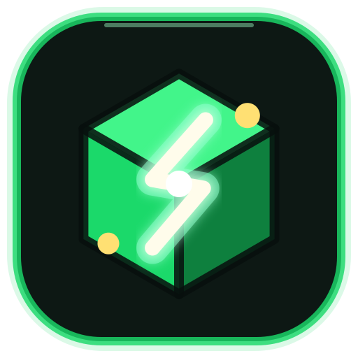

<div align="center">
  
  <h1>Svarka Launcher</h1>
  <p><strong>Fast, native Minecraft launcher built in pure Rust (<code>eframe</code> / <code>egui</code>)</strong></p>

  <p>
    <a href="https://github.com/svarkawm/svarka-launcher/releases">
      
    </a>
    <a href="https://github.com/svarkawm/svarka-launcher/actions/workflows/build.yml">
      
    </a>
    
    
    <a href="LICENSE">
      
    </a>
  </p>

  <p>
    
  </p>
</div>

## Features
- **Instances & Profiles**: create, duplicate, edit, and delete instances with isolated `instances/<profile_id>` game directories.
- **Mod Loaders**: supports **Vanilla**, **Fabric**, **Quilt**, **Forge**, and **NeoForge** via official Mojang, Fabric/Quilt Meta, and Forge/NeoForge Maven APIs (including Forge/NeoForge installer processors).
- **Modrinth Integration**: search and install mods, modpacks (`.mrpack`), resource packs, and shaders with file enable/disable toggling inside each instance's Content manager.
- **High-Speed Parallel Downloads**: pooled async downloads (up to 64 concurrent transfers) with streaming SHA-1 verification and automatic extraction of native libraries (`natives`).
- **Accounts**: supports **Microsoft** (OAuth Device Code), **Ely.by** (`authlib-injector`), and **Offline** local accounts.
- **JVM & Runtime Management**: RAM allocation (`-Xms` / `-Xmx`), custom JVM arguments & presets (`G1GC`, `ZGC`, `Aikar's`), and automatic Java runtime discovery.
- **Command Palette (`Ctrl+K`)**: quick keyboard navigation across instances, pages, and launcher actions.
- **Live Console**: real-time filtered `stdout` / `stderr` game log viewer with auto-scroll and copy/clear actions.

## Screenshots

<table>
  <tr>
    <td></td>
    <td></td>
  </tr>
  <tr>
    <td></td>
    <td></td>
  </tr>
</table>

## Quick Start (Releases)

Download the prebuilt binary for your OS from [GitHub Releases](https://github.com/svarkawm/svarka-launcher/releases):

- **Linux (`svarka-launcher-linux-x64`)**: mark the file as executable before the first launch:
  ```bash
  chmod +x ~/Downloads/svarka-launcher-linux-x64
  ~/Downloads/svarka-launcher-linux-x64
  ```
  On first run, the launcher automatically installs its icon and application menu entry (`~/.local/share/applications/svarka-launcher.desktop`).
- **Windows (`svarka-launcher-windows-x64.exe`)**: run the `.exe` directly.

## Build & Run

```bash
cargo build --release
cargo run
```

## Tests

```bash
cargo test
```

## Data Storage
By default, launcher data is stored in:
- **Linux**: `~/.local/share/mc-launcher`
- **Windows**: `%LOCALAPPDATA%\mc-launcher` (`C:\Users\<User>\AppData\Local\mc-launcher`)

Inside this folder:
- `profiles.json` — instance profiles
- `accounts.json` — saved accounts
- `versions/` — version JSONs, client JARs, loader overlays, and extracted `natives`
- `libraries/` — shared Maven libraries
- `assets/` — asset indexes and resource objects
- `instances/` — isolated game directories per instance
- `java/` — optional launcher-local Java runtimes

## Credits & License
- **Author**: `svarka` ([@svarkawm](https://github.com/svarkawm))
- **Co-Author / AI Contributor**: **Antigravity (Gemini)**
- **License**: [MIT](LICENSE)

